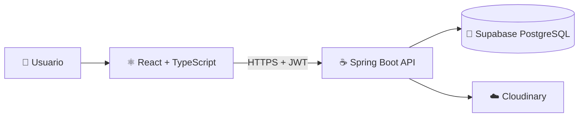

<div align="center">

# 🚛 GENLOGS S.A.C.

### Sistema Web de Gestión Comercial e Industrial

*Conectando el suministro y el destino de tecnologías y equipos con máxima precisión.*


[📖 Empresa](#-acerca-de-la-empresa) •
[🎯 Propósito](#-propósito-del-sistema) •
[🛠️ Stack](#️-stack-tecnológico) •
[🔐 Seguridad](#-seguridad-en-capas) •
[🚀 Instalación](#-configuración-e-instalación)

</div>

---

## 📖 Acerca de la empresa

**GENERAL LOGISTIC SOLUTIONS S.A.C. (GENLOGS)** nació el **7 de junio de 2007**, impulsada por la visión de alcanzar un alcance global en la comercialización y el suministro industrial. Su nombre comercial evoca la figura del genealogista: el especialista que rastrea conexiones de origen y trazabilidad, reflejando su rol como puente entre el suministro y el destino de tecnologías y equipos.

GENLOGS ofrece soluciones industriales integrales para los sectores de **minería, manufactura, química y alimentación**, desarrollando relaciones duraderas basadas en la confianza, la innovación y la entrega oportuna de productos de calidad.

---

## 🎯 Propósito del sistema

Plataforma integral que optimiza y automatiza la cadena de valor comercial y logística de la empresa. Este repositorio contiene el **backend** (API REST) que da soporte al frontend desarrollado en React.

| Módulo | Descripción |
|---|---|
| ⚡ **Cotizador Express y Simulador TCO** | Generación rápida de cotizaciones con cálculo comparativo del costo total de propiedad frente a fabricantes OEM. |
| 📋 **Tablero Kanban de Homologación** | Seguimiento transparente, en 4 fases, de la homologación de repuestos y proveedores mineros. |
| 🦺 **Dossier SST para Garita** | Administración y verificación en tiempo real de SCTR, EPP, exámenes médicos y choferes para un ingreso fluido a mina. |
| 🧾 **Facturación Electrónica y Factoring** | Seguimiento de comprobantes SUNAT (XML, PDF, CDR) e integración con operaciones de financiamiento. |

---

## 🛠️ Stack tecnológico

| Capa | Tecnologías |
|---|---|
| **Backend** | Java 17, Spring Boot 3.x, arquitectura MVC / API RESTful |
| **Seguridad** | Spring Security, JWT, BCrypt |
| **Persistencia** | Spring Data JPA, Hibernate |
| **Base de datos** | Supabase (PostgreSQL) |
| **Multimedia** | Cloudinary API (archivos, URL seguras y metadatos en BD) |
| **Frontend** | React con TypeScript, React Router DOM, Tailwind CSS / CSS Modules |
| **Cliente HTTP** | Axios con interceptores JWT |
| **UX** | Lottie React, Skeleton Loaders |

---

## 🏗️ Arquitectura



---

## 🔐 Seguridad en capas

- 🔑 **Autenticación:** credenciales validadas contra hash BCrypt.
- 🎟️ **Sesiones stateless:** token JWT firmado en `Authorization: Bearer <TOKEN>`.
- 👥 **Control de acceso por roles (RBAC):** restricción de endpoints y componentes UI.
- 🛡️ **Protección de datos:** prevención de SQL Injection vía JPA/Hibernate y comunicación HTTPS.
- ⏳ **Tokens temporales:** recuperación de contraseña con enlaces firmados de un solo uso y con expiración.

### Roles del sistema

| Rol | Alcance |
|---|---|
| 🛠️ **Administrador** | Gestión completa de la plataforma |
| 💼 **Vendedor** | Cotizaciones, clientes y órdenes de compra |
| ⛏️ **Cliente Minero** | Seguimiento de homologación y comprobantes |
| 🚧 **Agente de Garita** | Validación de choferes y documentación SST |

---

## 📂 Estructura del backend

```
genlogs-backend/
├── src/main/
│   ├── java/com/genlogs/app/
│   │   ├── config/        # CORS, Cloudinary, Beans
│   │   ├── controller/    # Controladores REST
│   │   ├── dto/           # Objetos de transferencia de datos
│   │   ├── exception/     # Manejo global de excepciones
│   │   ├── model/         # Entidades JPA
│   │   ├── repository/    # Spring Data JPA
│   │   ├── security/      # Spring Security + JWT + BCrypt
│   │   ├── service/       # Lógica de negocio
│   │   └── util/          # Utilidades y encriptación
│   └── resources/         # application.properties
└── pom.xml
```

<details>
<summary><b>🖥️ Ver estructura del frontend (genlogs-frontend)</b></summary>

```
src/
├── assets/        # SVG, Lottie JSON, imágenes corporativas
├── components/    # Header, Sidebar, LoadingSpinner, Modal
├── context/       # AuthContext
├── pages/         # Login, Dashboard, Cotizador, Kanban, Dossier SST...
├── routes/        # Rutas protegidas por rol
├── services/      # Axios y interceptores (authApi.ts)
└── types/         # Interfaces TypeScript
```

</details>

---

## 🚀 Configuración e instalación

**Prerrequisitos:** Java JDK 17+, Node.js 18+ con npm o yarn, y cuentas en Supabase y Cloudinary.

```bash
# 1. Clonar el repositorio
git clone https://github.com/<tu-usuario>/genlogs-backend.git
cd genlogs-backend

# 2. Configurar credenciales en src/main/resources/application.properties
#    (Supabase, Cloudinary y clave secreta JWT)

# 3. Ejecutar el backend
./mvnw spring-boot:run        # En Windows: mvnw.cmd spring-boot:run
```
---
<div align="center">

⭐ *Si este proyecto te resulta útil, no olvides darle una estrella.* ⭐

</div>
